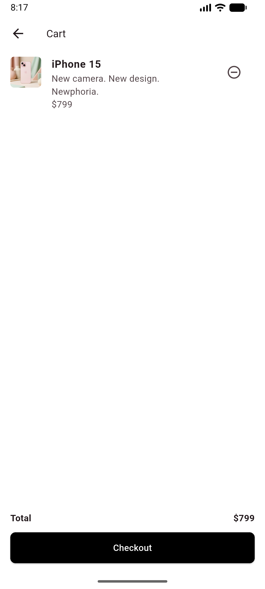
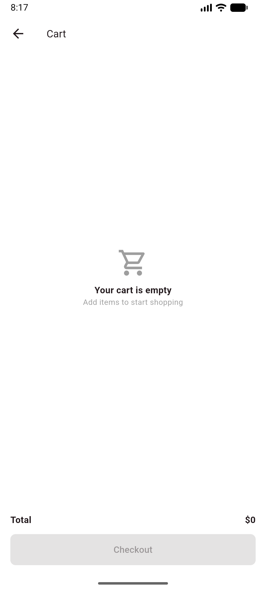

# Mini Katalog

Flutter ile geliştirilmiş basit bir ürün katalog uygulaması. Eğitim kapsamında hazırlanmıştır.

## Kısa Açıklama

Uygulama, ürünleri bir test API'sinden çekip 2 sütunlu kart yapısında listeler. Kullanıcı ürünleri arayabilir, bir ürüne tıklayarak detay sayfasını görebilir ve ürünü sepete ekleyebilir.

## Özellikler

- Ana sayfa: banner, arama kutusu ve GridView ile ürün kartları
- Ürün arama ve filtreleme (ürün adı ve alt başlığa göre)
- Ürün detay sayfası (açıklama ve özellikler)
- Sayfalar arası geçiş (Navigator) ve Route Arguments ile ürün taşıma
- Sepete ekleme, sepetten çıkarma, toplam fiyat ve boş sepet ekranı
- Model sınıfı (`fromJson` / `toJson`) ile JSON veri okuma

## Kullanılan Flutter Sürümü

- Flutter 3.47.7 (stable)
- Dart 3.13.5

Ekstra paket kullanılmamıştır, yalnızca Flutter'ın kendi kütüphaneleri vardır.

## Veri Kaynağı

Eğitim amaçlı test verisi kullanılmıştır:

- Ürünler: https://wantapi.com/products.php
- Banner: https://wantapi.com/assets/banner.png

Uygulamanın ürünleri yükleyebilmesi için internet bağlantısı gerekir.

## Çalıştırma Adımları

1. Flutter SDK'nın kurulu olduğundan emin olun: `flutter --version`
2. Projeyi bilgisayarınıza indirin:
```
   git clone <repository-url>
   cd mini_katalog
```
3. Bağımlılıkları yükleyin:
```
   flutter pub get
```
4. Bir Android emulator başlatın ya da Android cihaz bağlayın.
5. Uygulamayı çalıştırın:
```
   flutter run
```

## Proje Yapısı

```
lib/
  main.dart      # Uygulama, ana sayfa, ürün kartı, detay ve sepet sayfaları
  product.dart   # Product model sınıfı
  cart.dart      # Sepet durumu ve yardımcı fonksiyonlar
```

## Ekran Görüntüleri

| Ana Sayfa | Ürün Detayı | Sepet | Boş Sepet |
|-----------|-------------|-------|-----------|
|  |  |  |  |